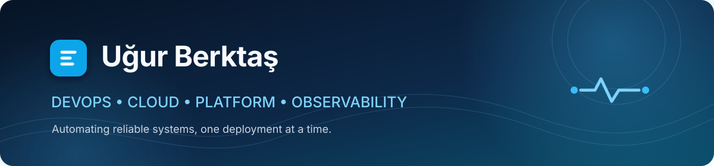

  

  Yazılım mühendisliği, bulut altyapıları ve gözlemlenebilir sistemler üzerine çalışıyorum. 
  Güvenilir, otomasyonu güçlü ve ölçülebilir sistemler kurmayı seviyorum.

  
  
  

## Hakkımda

- 🎓 Fırat Üniversitesi Yazılım Mühendisliği öğrencisiyim.
- ☁️ AWS, Docker, Kubernetes ve Proxmox ile bulut ve sanallaştırma altyapıları geliştiriyorum.
- ⚙️ CI/CD, Linux sistem yönetimi ve servis otomasyonu üzerine çalışıyorum.
- 📊 Prometheus ve Grafana ile izleme ve observability çözümleri kuruyorum.
- 🔐 Zero Trust yaklaşımı ve Cloudflare Tunnel ile güvenli ağ mimarileri tasarlıyorum.
- 🧩 DevOps pratiğini platform mühendisliği, dağıtık sistemler ve güvenlik odaklı projelerle birleştiriyorum.

## Teknoloji setim

  

  

## GitHub istatistikleri

  
  

  <picture>
    <source media="(prefers-color-scheme: dark)" srcset="https://raw.githubusercontent.com/ugurberktas/ugurberktas/output/github-contribution-grid-snake-dark.svg" />
    <source media="(prefers-color-scheme: light)" srcset="https://raw.githubusercontent.com/ugurberktas/ugurberktas/output/github-contribution-grid-snake.svg" />
    
  </picture>

  <i>Birlikte üretmek veya teknik bir konu üzerine konuşmak istersen bana ulaşabilirsin.</i>

